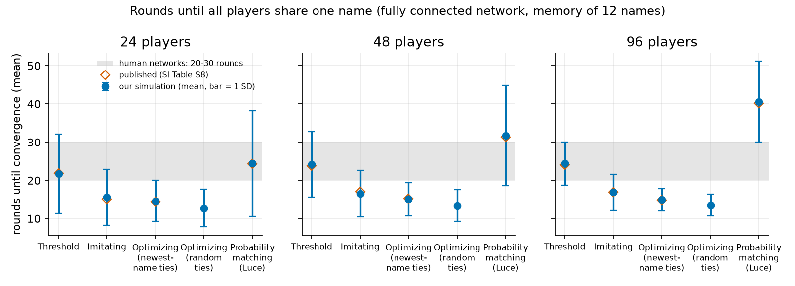
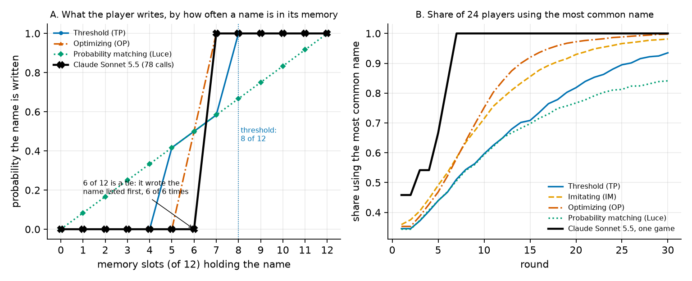

# Naming game with threshold, imitating, optimizing and LLM agents: preliminary results

Milan Gorislavets and Kamilya Mukh. Code: https://github.com/themilan1337/naming-game-agents

**Setup.** The naming game of Guilbeault, Caplan and Yang (PNAS 2026): players are paired at random on a fully connected network and each writes a name; a player's memory is the last 12 names it saw. Four rules draw from that memory: threshold (a name in at least 8 of 12 slots is always written, otherwise a slot is sampled), imitating, optimizing and probability matching (Luce). Checks used: SI Table S8 and Fig. 3C.

**Reproduction.** Rounds to a shared name (3,000 runs per cell) are within 0.6 round of SI Table S8 for threshold (21.77 / 24.19 / 24.44 against 21.83 / 23.81 / 24.13 at N = 24 / 48 / 96), imitating and Luce, and the next-choice accuracies on the human data are close to Fig. 3C (threshold 87.9%, 7,815 of 8,893 choices, the paper's n; imitating 81.1%, optimizing 75.2% (newest-name ties, looser determinism test of the released code) and 74.8% (random ties, unique plurality), Luce 53.4%, on rounds after 12, with our n different). The optimizing agent matches Table S8 (14.61 / 15.06 / 14.99 against 14.44 / 15.20 / 14.89) only if ties go to the most recently heard name; with random ties, as the text says, it converges 1.4 to 1.7 rounds faster.

**LLM agents.** One model, Claude Sonnet 5.5, queried one call at a time through the Claude command-line client on 8 and 9 Nov 2026 (default sampling). The model sees the same 12-name memory and answers with one name. In a probe with a name held in k of 12 slots (6 repeats for each k from 0 to 12, 78 calls), it wrote that name in every repeat from k = 7 and in none up to k = 5; at k = 6 (a 6 to 6 tie) it wrote the name listed first, 6 of 6 times. So its choice is a step at a simple majority, with no probabilistic region, and it looks like the optimizing agent, not the threshold one.

One game with 24 players, 30 rounds (720 calls): all 24 players used one name from round 7; the rule agents (300 runs each) need 18.4 (threshold), 14.6 (imitating), 12.8 (optimizing) and 18.1 (Luce) rounds on average among runs done by round 30.

With a committed minority (3 and 6 of the 24 players always write a new name; one 30-round game each, 1,170 calls), 0 of 21 and 3 of 18 other players wrote the new name in round 30, so no flip; the rule agents average 0.6% and 34.5% (threshold), 0.2% and 12.2% (optimizing) and 94.2% and 100% (imitating). Second chart: probe (A), game (B).

**Limits.** One model, one game per condition, 6 repeats per k, 0 of 1,968 calls needed a fallback: a first look, not an estimate. The model has not yet been given the recorded human sequences from your repository; it played a new game with 24 copies of itself on a complete network.

Is the tie rule for optimizing agents that fits Table S8 the one you intend?

{width=84%}

{width=84%}

References: Guilbeault, Caplan, Yang, PNAS 123(17):e2508061123 (2026); Centola and Baronchelli, PNAS 112(7):1989 (2015); Centola, Becker, Brackbill, Baronchelli, Science 360(6393):1116 (2018).
